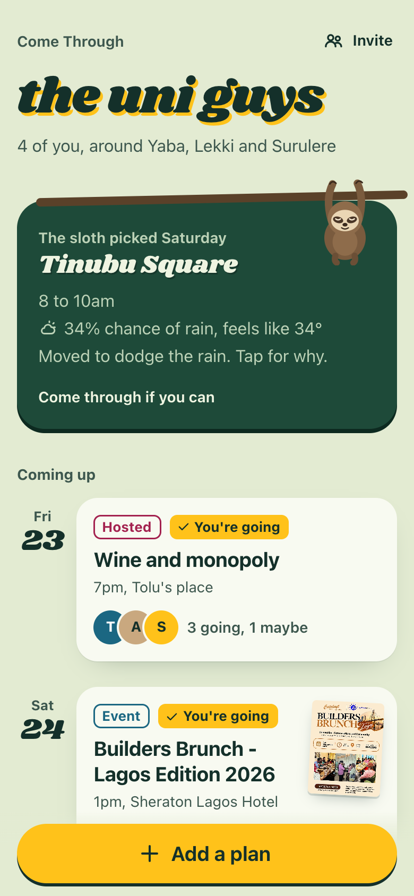
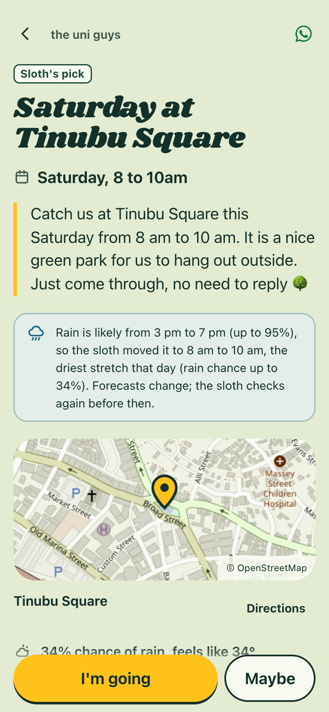
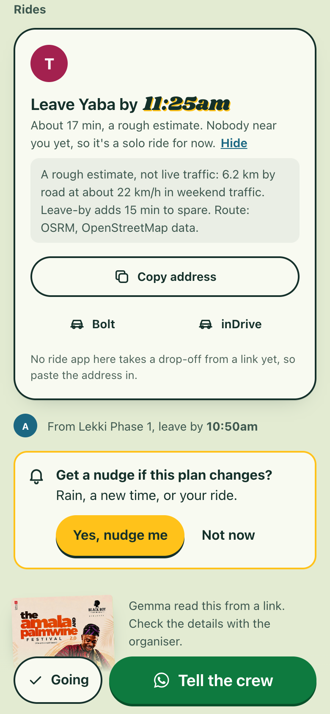

# Come Through

**The group chat does the asking. You just come through.**

Built for Hacktoberfest 2026, DEV Week 3, "Slow and Steady": make something with open-source
AI that rewards laziness. Come Through is a crew organiser for people who would rather not
organise. Plans arrive the lazy way, your friends tap once, and the rides and reminders sort
themselves out. If nobody plans anything, a sloth does it for you.

"Come through" is Nigerian English for "show up". The app is built for friend groups in
Lagos, where the hard part of meeting up is rarely the wanting. It is the asking, the
waiting for answers, the choosing of a place and the traffic.

**Built for my crew in Lagos. Works in your city; deepest where there's a city pack.**

<p>
  
  
  
</p>

Screens from a real run on 21 Oct 2026 with live Gemma, Photon, Overpass, OSRM and
Open-Meteo. More in [docs/screens/real](docs/screens/real), including the plain page Opera
Mini gets ([23-opera-mini-basic-plan.png](docs/screens/real/23-opera-mini-basic-plan.png)).
What the app claims about Lagos, and where each claim comes from, is in
[docs/LOCAL-FACTS.md](docs/LOCAL-FACTS.md).

## What it does

- **Start a crew in one sentence.** "The uni guys, every other Saturday, somewhere outside
  and cheap, around Yaba and Lekki." Gemma reads the name, the rhythm, the vibe and the
  areas. You check them and get an invite link for the group chat.
- **Join with a name and a neighbourhood.** No account, no phone number, no email.
- **Add a plan the lazy way.** Share a flyer picture, paste an event link or type one
  sentence ("wine and monopoly at mine friday 7, bring a bottle"). Gemma fills in the
  details and highlights what it guessed.
- **Tap once.** "I'm going" or "Maybe". Saying nothing is a fine answer.
- **Rides sort themselves.** People going from nearby areas are grouped into ride pods with a
  leave-by time and the address to copy. In Lagos there are buttons for Bolt and inDrive (the
  apps people use since Uber left Nigeria in September 2026); no ride app there takes a
  drop-off from a link, so the app says so and you paste it. In a city with no pack, no app
  is named, and "Get directions" opens your maps app. Ride times are labelled as estimates,
  and "How we guess" shows the assumption.
- **The sloth's ritual.** If the crew has a regular day and nobody planned anything, Come
  Through picks a green spot near the middle of the crew from OpenStreetMap, checks the
  weather, and posts the plan two or three days ahead. If rain is coming, it moves to a
  drier stretch inside the hours people actually go out (in Lagos, 11 am to 6:30 pm at the
  weekend), and when there is none it skips the week and says why.
- **The sloth has 3 ideas.** "Too lazy to think?" One card, three things to do tonight or
  this weekend: a green spot near the middle of the crew (when the forecast is dry), a place
  the crew already liked, and in Lagos an event from the **Awe Lagos** and **Nothing To Do
  In Lagos** weekly guides, read from their RSS feeds and credited with a link to the post.
  Code filters by time, distance and weather; Gemma ranks and writes one line each, and any
  line with a number it made up is replaced. One tap makes an idea a plan.
- **WhatsApp first.** Plans travel the way Lagos crews already talk: every "tell the crew"
  button opens WhatsApp with the plan's link in the message (after you post a plan, after
  you say you're going, the invite, the rain heads-up). Web Push is the extra nudge for
  people who turn it on, and the calendar (a one-tap file after "I'm going", or a feed for
  iPhone and laptops) is there for those who want it.

## How it works

Each job goes to the tool that is good at it. Gemma handles messy human input and writing.
Open data supplies the facts. Plain, tested code does every bit of arithmetic and every
decision about fairness.

| Job | Done by | Why |
|---|---|---|
| Read a flyer, a web page or a sentence into a plan | Gemma 4 (with vision for flyers), JSON output | People write plans in every possible way |
| Read the crew's setup sentence | Gemma 4 | Language |
| Explain the sloth's pick and write its invite | Gemma 4, checked by code | Language; any number not in the facts is thrown away |
| Rank the 3 ideas and say why | Gemma 4, after code has filtered by time, distance and weather | Taste is language; the filters are facts |
| Read a curated weekly guide into events | Gemma 4, then code keeps only what the post states | Messy text; nothing invented survives |
| Turn "friday 7" into a date and time | Code | A model should never do date arithmetic |
| Find neighbourhoods and venues on the map; the crew's city | Photon and Nominatim (OpenStreetMap), cached | Facts |
| The crew's time zone | Open-Meteo (`timezone=auto`) | Open data |
| Find parks and beaches near the crew | Overpass (OpenStreetMap), plus 38 checked Lagos spots in Lagos, or Wikidata's parks and beaches nearby elsewhere | Open data |
| Pick the weather window | Open-Meteo | Open data |
| Road distances and which bridge a trip takes | OSRM (OpenStreetMap), cached | Open data |
| Choose a fair place, group rides, set leave-by times | Code, with tests | Fairness and arithmetic |
| Calendar files and feeds | Code (RFC 5545) | Standards |

The code is split so this stays true. `src/core` is pure and has no network, clock or
randomness (a test enforces it), and it names no city: what is local lives in
`src/packs`. `src/adapters` wraps each outside service and has a fake for tests. `src/app`
puts them together, and `src/server` is plain HTTP. The web app in
`web/` is Preact and Vite.

## City packs

Come Through has a global core and city packs. Every crew gets a region from its own
neighbourhoods (the country and city from OpenStreetMap, the time zone from Open-Meteo), and
the region picks a pack:

- **Lagos** has a pack: 38 checked spots, sourced entry fees, Bolt, inDrive and LagRide,
  Lagos traffic bands and the lagoon bridges, the hours people go out, Pidgin and "VI" in
  the prompts, and naira. Every claim has a source and a date in
  [docs/LOCAL-FACTS.md](docs/LOCAL-FACTS.md).
- **Anywhere else** gets the default pack, which makes no local claims: parks and beaches
  from OpenStreetMap and Wikidata near the crew, travel times from OSRM labelled as rough,
  "Get directions" and "Copy address" instead of naming a ride app nobody has checked,
  generic social hours, your own time zone, and prices as the source writes them.

Tested live in London, Berlin, Nairobi, Bengaluru and New York, with Lagos as the control
([docs/LOCAL-FACTS.md, "Beyond Lagos"](docs/LOCAL-FACTS.md#beyond-lagos)). To add your city,
see [docs/CITY-PACKS.md](docs/CITY-PACKS.md): spots with sources, ride apps with dated
sources, and traffic notes.

## Run your own sloth

Every Gemma task goes through one port (`src/adapters/llm.mjs`). The default is Gemma 4 on
Google's Gemini API. Set `LLM=ollama` and the same tasks run on Gemma on your own machine or
server through [Ollama](https://ollama.com):

```sh
ollama pull gemma3:4b                       # or any Gemma you like; 12b and up read better
LLM=ollama OLLAMA_MODEL=gemma3:4b npm run dev
node scripts/llm-check.mjs                  # three tasks through the port, with timings
```

Why open weights matter here:

- **No lock-in.** The app does not depend on one company's API, its quota or its pricing.
  Gemma's weights are open, so the sloth keeps working if the free API changes.
- **Free.** No key and no bill. A recent laptop or a small GPU server is enough.
- **Your crew's words stay on your machine.** With `LLM=ollama`, nothing goes to Google:
  not the setup sentence, not the plans, not the ideas.

The trade-offs, measured on 21 Oct 2026 on a 2017 MacBook Pro (Intel Core i5, CPU only, no
GPU) with `gemma3-4b-hf`: reading the crew sentence took 217 s, reading a plan sentence
300 s and explaining the sloth's pick 89 s, all three right. A recent Mac or any GPU is many
times faster. Reading a flyer needs a model with vision: Ollama says whether the model has
one, and a text-only model answers "Reading a flyer needs a vision model ... Type the plan
or paste the link instead." Settings: `OLLAMA_URL` (default `http://localhost:11434`),
`OLLAMA_MODEL`, `OLLAMA_VISION=auto|yes|no`, `OLLAMA_TIMEOUT_MS` (default 180000).

## Privacy

- Gemma runs through Google's free Gemini API, and Google may use what it receives to improve
  its products. So we send only what is needed, and the app says so wherever Gemma is used:
  - **Start a crew**: the sentence you typed.
  - **Add a plan**: your sentence, the flyer picture, or the link with its page's text.
  - **The sloth's note**: the place, the weather, the crew's vibe words and the minutes from
    each neighbourhood. No names.
  - **The 3 ideas**: each idea's name, time, place, price and weather, the crew's vibe words
    and budget, and the minutes from each neighbourhood. No names.
  - Or none of it: with `LLM=ollama`, Gemma runs on your own machine (see "Run your own sloth").
- The Lagos weekly guides are read only from their public RSS feeds, at most once a day,
  while their robots.txt allows it. Only short facts are kept (name, date and time, venue,
  price, ticket link), each idea links back to the guide's post, and the posts' text is never
  stored or shown.
- Your crew list and where people live stay with Come Through. Members give a name and a
  neighbourhood, never an address or a phone number. A host's home address is shown only to
  crew members.
- Links carry unguessable tokens. Responses set `Referrer-Policy: no-referrer`, and logs
  never include query strings.
- Instagram and Facebook links are never fetched. The app asks for the flyer picture instead.

## Quickstart

You need Node 20.19 or later.

```sh
npm install
npm --prefix web install && npm --prefix web run build
OFFLINE=1 npm run dev
```

Open http://localhost:3000. With `OFFLINE=1` every outside service is faked (a regex plays
Gemma), so you need no keys and no network.

For the real thing, copy `.env.example` to `.env`, add `GEMINI_API_KEY`
(aistudio.google.com/apikey) and run `npm run dev`.

```sh
npm test                 # 179 tests: core, city packs, ideas, the LLM port, adapters, service and the HTTP API
npm run typecheck        # tsc over the JSDoc types
npm run e2e -- http://localhost:3000 <event link>   # the whole flow against a running server
```

For UI work, `npm --prefix web run dev` starts Vite on port 5173 and proxies the API to port
3000. Add `?mock=1` to any page to use the built-in demo data.

## Deploy

One free Render web service in Frankfurt, MongoDB Atlas M0 in Frankfurt, and a GitHub
Actions schedule for the heartbeat. `render.yaml` describes the service. The steps, the
checks after deploy, and the list of things to try on a real phone are in
[docs/DEPLOY.md](docs/DEPLOY.md).

## More

- [docs/SPEC.md](docs/SPEC.md): the product and the API contract
- [docs/DESIGN.md](docs/DESIGN.md): the look (a hand-painted Lagos afternoon)
- [docs/NOTES.md](docs/NOTES.md): engineering notes, live test results and open items
- [docs/LOCAL-FACTS.md](docs/LOCAL-FACTS.md): every claim about Lagos, with its source and the date it was checked, and the live tests beyond Lagos
- [docs/CITY-PACKS.md](docs/CITY-PACKS.md): how to add a city pack

## Credits

- **Selects** ([github.com/IkpemosiArnold/selects](https://github.com/IkpemosiArnold/selects),
  MIT): the Gemini API client pattern, JSON salvage, the rate limiter and the proxy rule.
  Details in [CREDITS.md](CREDITS.md).
- **OpenStreetMap**: places, parks and map tiles. © OpenStreetMap contributors, available
  under the Open Database License (ODbL),
  [openstreetmap.org/copyright](https://www.openstreetmap.org/copyright).
- **Photon** by komoot: geocoding and type-ahead over OpenStreetMap data.
- **Overpass API**: green spaces from OpenStreetMap.
- **Wikidata**: coordinates for Lagos spots OpenStreetMap does not have by name, and parks
  and beaches near crews in other cities (CC0).
- **Nominatim** (OpenStreetMap): the city a new crew is in, one lookup per crew.
- **OSRM**: road routes over OpenStreetMap data, for travel times ([project-osrm.org](https://project-osrm.org/)).
- **Open-Meteo**: weather forecasts. Weather data by
  [Open-Meteo.com](https://open-meteo.com/), licensed under CC BY 4.0.
- **Gemma** by Google DeepMind, an open model, served through the Gemini API.

## Licence

MIT. Copyright 2026 Arnold Ikpemosi Adeyemi. See [LICENSE](LICENSE).
