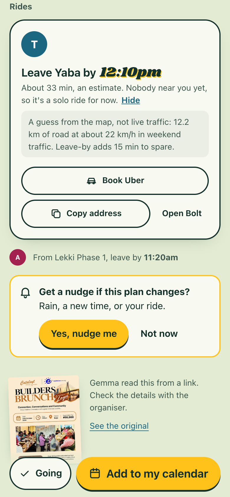

# Come Through

**The group chat does the asking. You just come through.**

Built for Hacktoberfest 2026, DEV Week 3, "Slow and Steady": make something with open-source
AI that rewards laziness. Come Through is a crew organiser for people who would rather not
organise. Plans arrive the lazy way, your friends tap once, and the rides and reminders sort
themselves out. If nobody plans anything, a sloth does it for you.

"Come through" is Nigerian English for "show up". The app is built for friend groups in
Lagos, where the hard part of meeting up is rarely the wanting. It is the asking, the
waiting for answers, the choosing of a place and the traffic.

<p>
  
  
  
</p>

Screens from a real run on 21 Oct 2026 with live Gemma, Photon, Overpass and Open-Meteo.
More in [docs/screens/real](docs/screens/real).

## What it does

- **Start a crew in one sentence.** "The uni guys, every other Saturday, somewhere outside
  and cheap, around Yaba and Lekki." Gemma reads the name, the rhythm, the vibe and the
  areas. You check them and get an invite link for the group chat.
- **Join with a name and a neighbourhood.** No account, no phone number, no email.
- **Add a plan the lazy way.** Share a flyer picture, paste an event link or type one
  sentence ("wine and monopoly at mine friday 7, bring a bottle"). Gemma fills in the
  details and highlights what it guessed.
- **Tap once.** "I'm going" or "Maybe". Saying nothing is a fine answer.
- **Rides sort themselves.** People going from nearby areas are grouped into ride pods with a
  leave-by time, an Uber link with the drop-off filled in, and the address to paste into
  Bolt. Ride times are labelled as estimates, and "How we guess" shows the assumption.
- **The sloth's ritual.** If the crew has a regular day and nobody planned anything, Come
  Through picks a green spot near the middle of the crew from OpenStreetMap, checks the
  weather, and posts the plan two or three days ahead. If rain is coming, it moves to a
  drier stretch inside the hours people actually go out (11 am to 6:30 pm at the
  weekend), and when there is none it skips the week and says why.
- **Reminders without an app.** Web Push nudges on Android and on iPhone (from the Home
  Screen), a one-tap calendar file after "I'm going", a calendar feed for iPhone and
  laptops, and a WhatsApp heads-up when rain moves in.

## How it works

Each job goes to the tool that is good at it. Gemma handles messy human input and writing.
Open data supplies the facts. Plain, tested code does every bit of arithmetic and every
decision about fairness.

| Job | Done by | Why |
|---|---|---|
| Read a flyer, a web page or a sentence into a plan | Gemma 4 (with vision for flyers), JSON output | People write plans in every possible way |
| Read the crew's setup sentence | Gemma 4 | Language |
| Explain the sloth's pick and write its invite | Gemma 4, checked by code | Language; any number not in the facts is thrown away |
| Turn "friday 7" into a date and time | Code | A model should never do date arithmetic |
| Find neighbourhoods and venues on the map | Photon (OpenStreetMap), cached | Facts |
| Find parks and beaches near the crew | Overpass (OpenStreetMap), plus 26 checked Lagos spots | Open data |
| Pick the weather window | Open-Meteo | Open data |
| Choose a fair place, group rides, set leave-by times | Code, with tests | Fairness and arithmetic |
| Calendar files and feeds | Code (RFC 5545) | Standards |

The code is split so this stays true. `src/core` is pure and has no network, clock or
randomness (a test enforces it). `src/adapters` wraps each outside service and has a fake
for tests. `src/app` puts them together, and `src/server` is plain HTTP. The web app in
`web/` is Preact and Vite.

## Privacy

- Gemma runs through Google's free Gemini API, and Google may use what it receives to improve
  its products. So we send only what is needed, and the app says so wherever Gemma is used:
  - **Start a crew**: the sentence you typed.
  - **Add a plan**: your sentence, the flyer picture, or the link with its page's text.
  - **The sloth's note**: the place, the weather, the crew's vibe words and the minutes from
    each neighbourhood. No names.
- Your crew list and where people live stay with Come Through. Members give a name and a
  neighbourhood, never an address or a phone number. A host's home address is shown only to
  crew members.
- Links carry unguessable tokens. Responses set `Referrer-Policy: no-referrer`, and logs
  never include query strings.
- Instagram and Facebook links are never fetched. The app asks for the flyer picture instead.

## Quickstart

You need Node 20.19 or later.

```sh
npm install
npm --prefix web install && npm --prefix web run build
OFFLINE=1 npm run dev
```

Open http://localhost:3000. With `OFFLINE=1` every outside service is faked (a regex plays
Gemma), so you need no keys and no network.

For the real thing, copy `.env.example` to `.env`, add `GEMINI_API_KEY`
(aistudio.google.com/apikey) and run `npm run dev`.

```sh
npm test                 # 99 tests: core, adapters, service and the HTTP API
npm run typecheck        # tsc over the JSDoc types
npm run e2e -- http://localhost:3000 <event link>   # the whole flow against a running server
```

For UI work, `npm --prefix web run dev` starts Vite on port 5173 and proxies the API to port
3000. Add `?mock=1` to any page to use the built-in demo data.

## Deploy

One free Render web service in Frankfurt, MongoDB Atlas M0 in Frankfurt, and a GitHub
Actions schedule for the heartbeat. `render.yaml` describes the service. The steps, the
checks after deploy, and the list of things to try on a real phone are in
[docs/DEPLOY.md](docs/DEPLOY.md).

## More

- [docs/SPEC.md](docs/SPEC.md): the product and the API contract
- [docs/DESIGN.md](docs/DESIGN.md): the look (a hand-painted Lagos afternoon)
- [docs/NOTES.md](docs/NOTES.md): engineering notes, live test results and open items

## Credits

- **Selects** ([github.com/IkpemosiArnold/selects](https://github.com/IkpemosiArnold/selects),
  MIT): the Gemini API client pattern, JSON salvage, the rate limiter and the proxy rule.
  Details in [CREDITS.md](CREDITS.md).
- **OpenStreetMap**: places, parks and map tiles. © OpenStreetMap contributors, available
  under the Open Database License (ODbL),
  [openstreetmap.org/copyright](https://www.openstreetmap.org/copyright).
- **Photon** by komoot: geocoding and type-ahead over OpenStreetMap data.
- **Overpass API**: green spaces from OpenStreetMap.
- **Open-Meteo**: weather forecasts. Weather data by
  [Open-Meteo.com](https://open-meteo.com/), licensed under CC BY 4.0.
- **Gemma** by Google DeepMind, an open model, served through the Gemini API.

## Licence

MIT. Copyright 2026 Arnold Ikpemosi Adeyemi. See [LICENSE](LICENSE).
